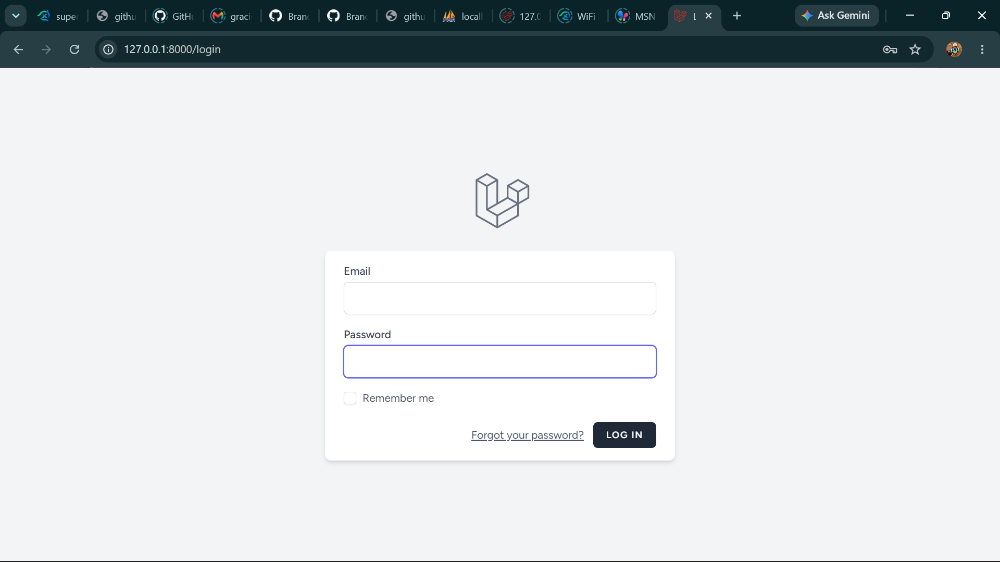
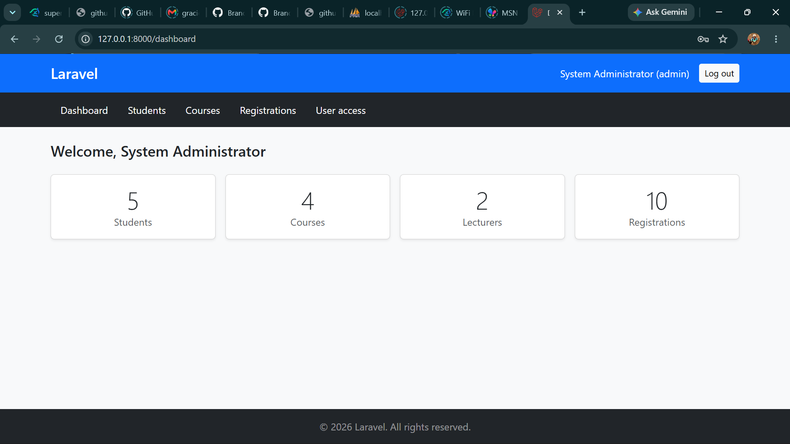
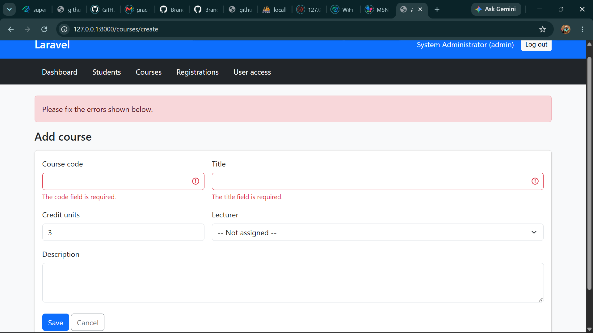
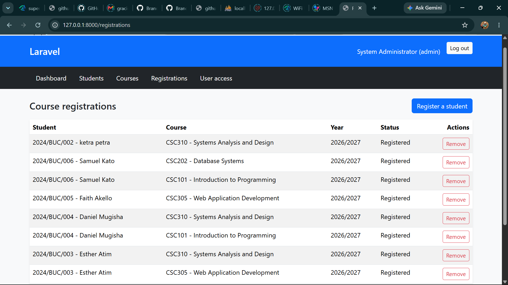
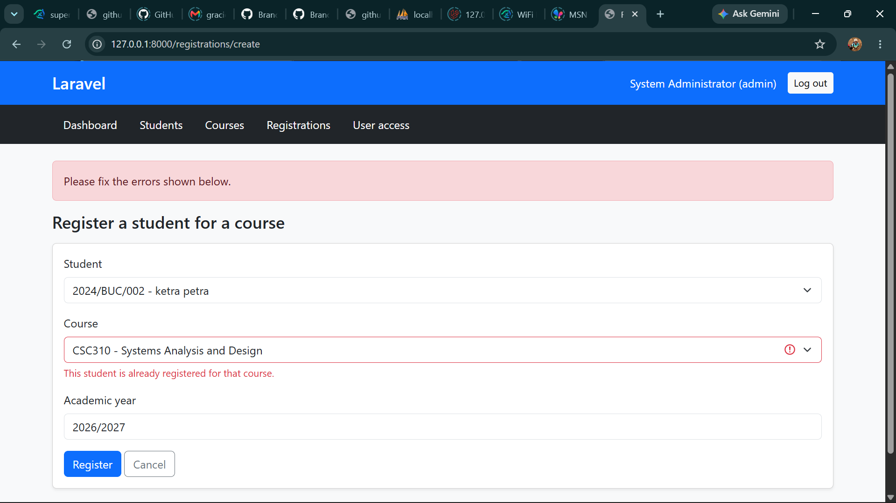
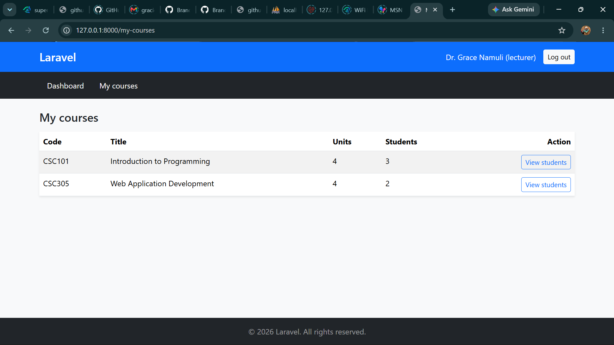
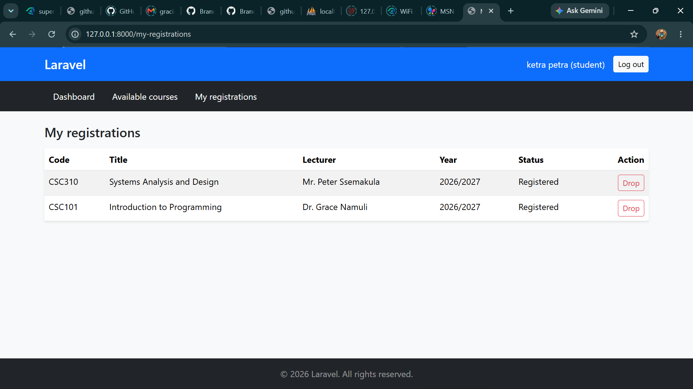
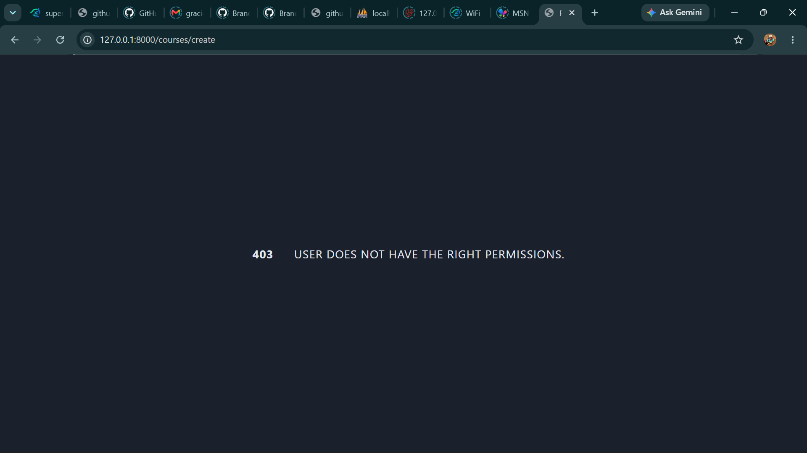

# Student Management System

A Laravel web application for managing students, courses, lecturers and course registrations, with role-based access for administrators, lecturers and students.

## Features

- Login and logout (Laravel Breeze)
- Roles and permissions (Spatie Laravel Permission): admin, lecturer, student
- Student and course management (create, view, edit, delete)
- Course registration with duplicate prevention
- Lecturers view their assigned courses and registered students
- Students view available courses and their own registrations
- Validation, success and error messages, and a reusable Blade layout

## Requirements

- PHP 8.2 or higher
- Composer
- MySQL (XAMPP is fine)
- Node.js and npm
- Git

## Installation

```bash
git clone https://github.com/graciousjr28-coder/student-management-system-AWAD.git
cd student-management-system
composer install
npm install
npm run build
copy .env.example .env
php artisan key:generate
```

On Mac or Linux use `cp .env.example .env`.

## Database setup

1. Start MySQL and create an empty database named `sms`.
2. Open `.env` and set:

```env
DB_CONNECTION=mysql
DB_HOST=127.0.0.1
DB_PORT=3306
DB_DATABASE=sms
DB_USERNAME=root
DB_PASSWORD=
```

3. Create the tables and sample data:

```bash
php artisan migrate:fresh --seed
```

4. Start the application:

```bash
php artisan serve
```

Open http://127.0.0.1:8000 in your browser.

## User roles

| Role | What the user can do |
| --- | --- |
| Administrator | Manage students, courses, registrations and user access (roles) |
| Lecturer | View assigned courses and the students registered for them |
| Student | View available courses, register, and view their own registrations |

## Sample login credentials

All sample accounts use the password `password`.

| Role | Email | Password |
| --- | --- | --- |
| Administrator | admin@sms.test | password |
| Lecturer | grace@sms.test | password |
| Lecturer | peter@sms.test | password |
| Lecturer | rebecca@sms.test | password |
| Student | ketra@sms.test | password |
| Student | joseph@sms.test | password |

## Screenshots











## Group members

| Name | Registration number | Branches |
| --- | --- | --- |
| Bikaba Grace | 24/U/23891/PS | feature/blade-layout, feature/registrations-portal, feature/documentation |
| Bwoye Canan | 24/U/23914/PS | feature/database-seeders, feature/lecturer-user-access |
| Edwin Opeded | 24/U/19629/PS | feature/auth-roles-permissions, feature/student-course-crud |
